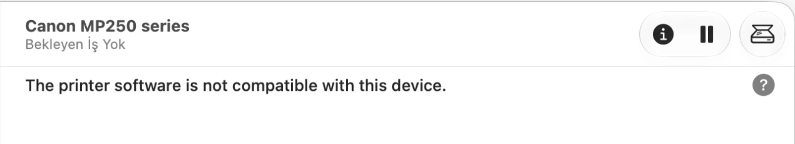

# Mac Printer Drivers

**Your printer isn't broken. macOS just stopped supporting it.**

Free drivers that bring 3,757 Canon, Epson, HP, Brother, Samsung and other printers back to life on Apple Silicon Macs, and let you print to them from your iPhone or iPad.

**[⬇ Download the free driver](https://github.com/theshiver/apple-silicon-printer-drivers/releases/latest)** · [Website](https://macprinterdrivers.com/) · [Is my printer supported?](https://macprinterdrivers.com/#search)

Seeing "The printer software is not compatible with this device"? This fixes it.

## Get printing in a minute

1. Plug the printer into your Mac with USB and switch it on.
2. **[Download the installer](https://github.com/theshiver/apple-silicon-printer-drivers/releases/latest)** and open it. It's signed and notarized by Apple.
3. Print. The installer finds your printer and sets it up.

Printer on Wi-Fi? Install the package, then add the printer in *System Settings → Printers & Scanners → Add → Use: Select Software…* and pick the entry ending in "Apple Silicon".

Using Homebrew? `brew install --cask theshiver/tap/apple-silicon-printer-drivers`

## Print from iPhone or iPad

Open **Print from iPhone & iPad** in Applications and turn your printer on. Your Mac adds AirPrint for it, even over USB, so it shows up in the Print menu on your iPhone and iPad. Works with any printer set up on the Mac. [See how it works](https://macprinterdrivers.com/print-from-iphone/).

It's off until you turn it on. The Mac has to stay on, and anyone on the same Wi-Fi can print to shared printers.

## Why it's worth installing now

Many printer makers never updated their Mac drivers for Apple Silicon. macOS 27 marks those drivers as incompatible, and Apple ends Rosetta for apps in macOS 28. This package doesn't need Rosetta, so your printer keeps working after you update.

## Supported printers

Canon (PIXMA, BJC) · Epson (Stylus, Expression, WorkForce) · HP (DeskJet, LaserJet, OfficeJet) · Brother · Samsung · Lexmark · Xerox · Kyocera · Ricoh · Oki · Dell · Sharp · Kodak · Sony · Fujifilm · Olympus

**[Search your model](https://macprinterdrivers.com/#search)** or see the [full list](https://macprinterdrivers.com/supported-printers.txt).

Not covered: scanners on all-in-ones, Brother DCP-T and MFC-T ink tanks, and dye-sublimation photo printers. Newer printers with AirPrint don't need a driver.

## Need help?

- **Still seeing the old error?** Restart the Mac once, then unplug and re-plug the printer.
- **Anything else:** see [troubleshooting](https://macprinterdrivers.com/troubleshooting/) or [open an issue](https://github.com/theshiver/apple-silicon-printer-drivers/issues) with your printer model and macOS version.

Advanced: Terminal steps

- `lpinfo -v` lists what macOS can see. A `usb://` line means the printer is found.
- `gutenprint-add --list "iP4300"` finds a model id, and `sudo gutenprint-add <model-id>` adds the printer by hand.
- For a network printer: `sudo gutenprint-add <model-id> MyPrinter socket://<printer-ip>`
- `grep printer-drivers /var/log/install.log` shows what the installer did.
- To uninstall: `sudo ./uninstall.sh`

## Is it safe?

The installer is signed and notarized by Apple, the source is open, and the driver collects nothing. Everything it does is listed in [SECURITY.md](SECURITY.md).

## ☕ Buy me a coffee

This started as a fix for one Canon PIXMA MP250 on a MacBook Air. It's free and always will be. If it saved you a new printer, you can [buy me a coffee on GitHub Sponsors](https://github.com/sponsors/theshiver). Thank you!

## License

Gutenprint: GPL-2.0 (`LICENSE-gutenprint`). brlaser: GPL-2.0-or-later (`pkgroot/Library/Printers/Gutenprint/share/brlaser/COPYING`); its corresponding source archive is shipped in the same directory. SpliX: GPL-2.0, statically linked with jbigkit (GPL-2.0-or-later) (`pkgroot/Library/Printers/Gutenprint/share/splix/COPYING`); both source archives are shipped in the same directory. foo2zjs: GPL-2.0-or-later (`pkgroot/Library/Printers/Gutenprint/share/foo2zjs/COPYING`); its corresponding source archive is shipped in the same directory. The HP firmware in `share/foo2zjs/firmware` belongs to HP and is not covered by these licenses. Scripts, installer and site: MIT (`LICENSE`).

Made by [Can Çetin](https://cancetin.com/).
